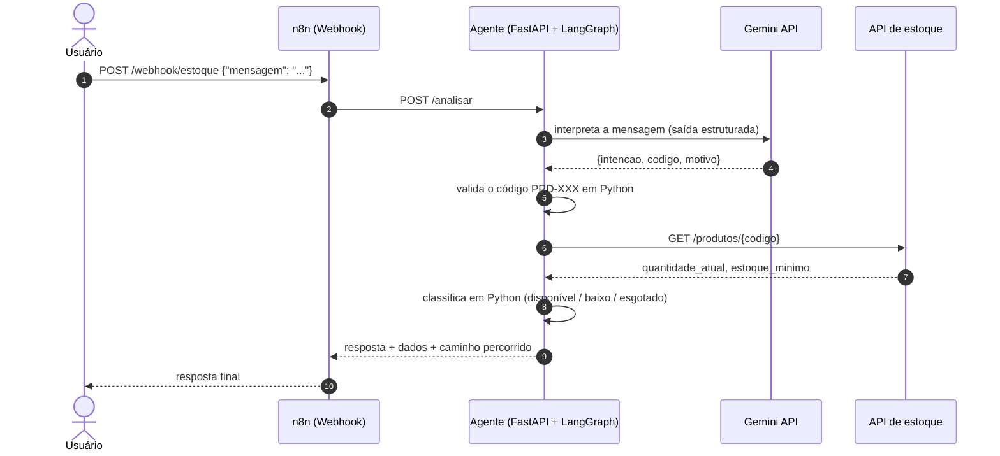
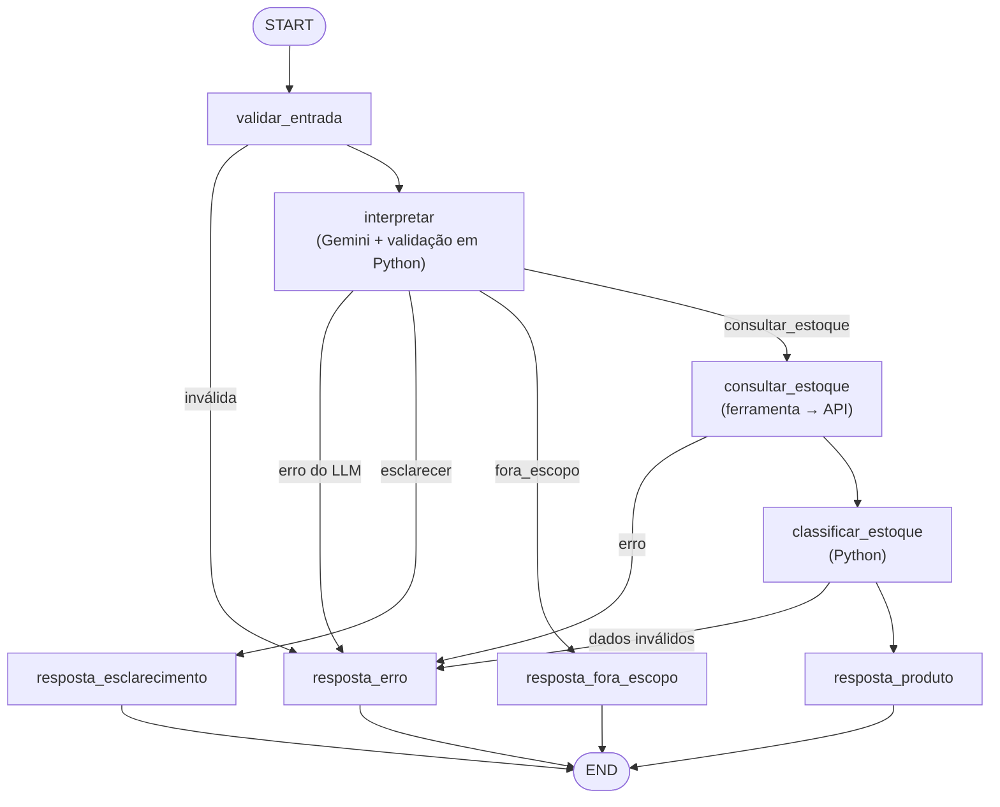
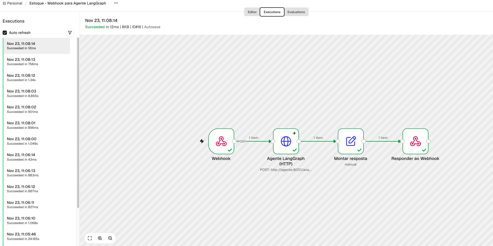

<div align="center">

# 📦 Agente de Análise de Estoque

**Pergunte em linguagem natural. Receba a situação do estoque com os dados que a comprovam.**

SCTEC · C1 · Agentes de IA · T2

[](https://www.python.org/)
[](https://docs.astral.sh/uv/)
[](https://langchain-ai.github.io/langgraph/)
[](https://ai.google.dev/)
[](https://fastapi.tiangolo.com/)
[](https://n8n.io/)
[](https://docs.docker.com/compose/)
[](docs/testes.md)
[](LICENSE)

</div>

---

## 📑 Sumário

- [Visão geral](#-visão-geral)
- [Início rápido](#-início-rápido)
- [Como funciona](#-como-funciona)
- [Configuração](#%EF%B8%8F-configuração)
- [Execução](#%EF%B8%8F-execução)
- [Automação com n8n](#-automação-com-n8n)
- [Confiabilidade e segurança](#%EF%B8%8F-confiabilidade-e-segurança)
- [Testes e evidências](#-testes-e-evidências)
- [Solução de problemas](#-solução-de-problemas)
- [Limitações](#-limitações)
- [Estrutura do projeto](#%EF%B8%8F-estrutura-do-projeto)
- [Autor](#-autor)
- [Licença](#-licença)

---

## 🎯 Visão geral

O agente responde se um produto está **disponível**, com **estoque baixo** ou **esgotado**, consultando a [API de estoque do professor](https://github.com/wangsouza/api-estoque).

Toda conclusão é **verificável**: a resposta sempre mostra produto, quantidade, mínimo e a regra aplicada, a partir dos dados retornados pela API.

```text
👤  Como está o estoque do PRD-001?

🤖  Produto PRD-001 — Mouse sem fio (Periféricos)
    Quantidade disponível: 5 un | Estoque mínimo: 10 un
    Situação: ESTOQUE BAIXO (quantidade 5 ≤ mínimo 10).
    Fonte: GET /produtos/PRD-001 da API de estoque.
```

| Princípio | Como é garantido |
|---|---|
| 🧠 **O LLM só interpreta** | O Gemini extrai intenção e código; consulta, classificação e texto final são Python. |
| 🔍 **Nada é inventado** | A situação vem dos dados da API; sem dados, não há classificação. |
| 🔒 **Somente leitura** | Pedidos de cadastro, alteração ou "ignore as regras" encerram sem consultar a API. |
| 🧩 **n8n só orquestra** | O n8n chama a interface HTTP do agente; toda a lógica fica no LangGraph. |

---

## 🚀 Início rápido

> Pré-requisitos: [uv](https://docs.astral.sh/uv/getting-started/installation/) (ou Python 3.11+), uma chave do [Google AI Studio](https://aistudio.google.com/apikey) e a API do professor rodando em `:8000`.

```bash
git clone https://github.com/francescousseau/sctec-inventory-agent.git
cd sctec-inventory-agent

uv sync                               # cria o .venv (Python 3.12) e instala as versões travadas no uv.lock
cp .env.example .env                  # preencha GOOGLE_API_KEY

uv run python -m agente_estoque "Como está o estoque do PRD-001?"
```

O `uv sync` lê o `pyproject.toml` (dependências), o `uv.lock` (versões exatas) e o `.python-version` (3.12). O `uv run` mantém o ambiente sincronizado antes de cada comando.

<details>
<summary><b>Sem uv (pip tradicional)</b></summary>

```bash
python -m venv .venv
source .venv/bin/activate             # Windows: .venv\Scripts\Activate.ps1
pip install -r requirements.txt
cp .env.example .env
python -m agente_estoque "Como está o estoque do PRD-001?"
```

O `requirements.txt` é gerado a partir do `uv.lock` (mesmas versões). Depois de mudar dependências no `pyproject.toml`:

```bash
uv lock && uv export --format requirements-txt --no-hashes --no-emit-project --all-groups -o requirements.txt
```

</details>

<details>
<summary><b>Subindo a API do professor (porta 8000)</b></summary>

```bash
git clone https://github.com/wangsouza/api-estoque.git && cd api-estoque
uv venv && uv pip install -r requirements.txt
uv run uvicorn app.main:app --host 0.0.0.0 --port 8000   # Swagger: http://127.0.0.1:8000/docs
```

`--host 0.0.0.0` permite que o agente em contêiner alcance a API via `host.docker.internal`.

</details>

---

## 🧭 Como funciona

### Fluxo de ponta a ponta



### Grafo LangGraph



- **Estado** (`estado.py`): `EstadoAgente` tipado (mensagem, intenção, código, produto, situação, erro, resposta, `caminho`).
- **Decisão condicional** (`grafo.py::apos_interpretacao`): consultar a API, pedir esclarecimento ou encerrar fora de escopo.
- **Encerramento:** grafo finito (DAG); todos os caminhos chegam a `END`, e a execução ainda é limitada por `recursion_limit=12`.
- **Validação da saída do LLM:** o código deve seguir `PRD-XXX`, aparecer **literalmente** na mensagem e ser o único; senão, o agente pede esclarecimento.
- **Dados da API nunca voltam ao LLM:** o Gemini só vê a mensagem do usuário, delimitada em `<mensagem_usuario>`, o que evita injeção por dados.

### Interpretação com Gemini

O cliente é o `ChatGoogleGenerativeAI` do `langchain-google-genai`, com **saída estruturada**:

```python
ChatGoogleGenerativeAI(model=settings.gemini_model, ...).with_structured_output(Interpretacao)
```

O Gemini devolve um objeto validado pelo schema Pydantic (`intencao`, `codigo`, `motivo`), e `validar_interpretacao` confere o código antes de qualquer consulta.

### Ferramenta de estoque (`estoque_tool.py::buscar_produto`)

| Item | Definição |
|---|---|
| Finalidade | `GET {ESTOQUE_API_URL}/produtos/{codigo}` (somente leitura) |
| Parâmetro | `codigo`: `PRD-XXX` (regex `PRD-[0-9]{3}`, validado antes de montar a URL) |
| Retorno | `ProdutoEstoque` (codigo, nome, categoria, quantidade_atual, estoque_minimo, unidade), com tipos estritos |
| Falhas | `CodigoInvalido`, `ProdutoNaoEncontrado` (404), `ServicoIndisponivel` (503/5xx/timeout/conexão), `RespostaInvalida` (JSON/estrutura/status inesperado/produto divergente) |
| Robustez | timeout; 1 retentativa só em falha de rede; sem redirecionamentos; URL-base configurável e fixa |

### Regra de classificação (`classificador.py`)

Confirmada no README da API do professor (§5):

| Condição | Situação |
|---|---|
| `quantidade == 0` | 🔴 **Esgotado** |
| `0 < quantidade <= mínimo` | 🟡 **Baixo** (igual ao mínimo conta como baixo) |
| `quantidade > mínimo` | 🟢 **Disponível** |

Dados ausentes, negativos ou de tipo errado geram erro controlado, sem classificação presumida.

---

## ⚙️ Configuração

Todas as configurações vêm de variáveis de ambiente ou do arquivo `.env` (nunca versionado).

| Variável | Padrão | Descrição |
|---|---|---|
| `GOOGLE_API_KEY` | — | Chave da Gemini Developer API ([criar](https://aistudio.google.com/apikey)). **Obrigatória.** |
| `GEMINI_MODEL` | `gemini-3.5-flash-lite` | Modelo do Gemini (o `gemini-2.5-flash-lite` não está mais disponível para chaves novas). |
| `LLM_TIMEOUT_S` | `30` | Tempo limite de cada chamada ao Gemini (segundos). |
| `ESTOQUE_API_URL` | `http://127.0.0.1:8000` | URL da API de estoque. No Docker Compose é fixada em `http://host.docker.internal:8000`. |
| `ESTOQUE_TIMEOUT_S` | `5` | Tempo limite das chamadas à API de estoque. |
| `ESTOQUE_RETRIES` | `1` | Novas tentativas só em falha de rede ou timeout. |
| `ESTOQUE_RETRY_BACKOFF_S` | `0.2` | Espera entre as tentativas. |
| `MENSAGEM_MAX_CHARS` | `500` | Tamanho máximo da pergunta. |

---

## ▶️ Execução

### CLI

```bash
uv run python -m agente_estoque "Como está o estoque do PRD-001?"
uv run python -m agente_estoque "Tem PRD-004 no estoque?" --json   # estado completo
uv run python -m agente_estoque "E o PRD-005?" -v                  # com logs
```

### Interface HTTP

```bash
uv run uvicorn --factory agente_estoque.servidor:criar_app --port 8001

curl -s -X POST localhost:8001/analisar -H 'Content-Type: application/json' \
     -d '{"mensagem":"Como está o estoque do PRD-004?"}'
```

A resposta inclui `resposta`, `desfecho`, `situacao`, `produto`, `api_consultada`, `caminho` (nós percorridos) e `erro`, para auditoria. Documentação interativa em `http://127.0.0.1:8001/docs`.

### 🐳 Docker Compose (agente + n8n)

Com o Docker Desktop ativo e a API do professor em `:8000`:

```bash
cp .env.example .env        # preencha GOOGLE_API_KEY
docker compose up --build -d
```

| Serviço | Endereço |
|---|---|
| Agente | http://localhost:8001/health |
| n8n | http://localhost:5678 |
| API do professor (host) | http://localhost:8000 |

O Compose usa `host.docker.internal` para o agente alcançar a API no host. Para parar: `docker compose down` (os dados do n8n ficam no volume `n8n-data`).

---

## 🔗 Automação com n8n

**Fluxo:** `Webhook (POST /webhook/estoque)` → `HTTP Request (POST /analisar)` → `Set (monta resposta + requer_atencao)` → `Respond to Webhook`.

O n8n **não decide nada**: LLM, estado, ferramenta e classificação ficam no LangGraph. Se o agente estiver fora do ar, o n8n responde com `desfecho: agente_indisponivel`.



1. No n8n, importe `n8n/workflow_estoque.json` (*Workflows → Import from file*) e publique o workflow.
2. **URL do nó HTTP:** o arquivo usa `http://agente:8001/analisar`, o nome do serviço no Compose.
   - n8n em contêiner avulso: `http://host.docker.internal:8001/analisar`
   - n8n direto no host (npm): `http://127.0.0.1:8001/analisar`
3. Teste:

```bash
curl -X POST http://127.0.0.1:5678/webhook/estoque -H 'Content-Type: application/json' \
     -d '{"mensagem":"Como está o estoque do PRD-004?"}'
```

No modo de teste do editor, use `/webhook-test/estoque`. Evidência completa: [`evidencias/n8n_execucao.md`](evidencias/n8n_execucao.md).

---

## 🛡️ Confiabilidade e segurança

- **Entrada validada:** mensagem vazia, longa demais ou com caracteres de controle é recusada antes do LLM.
- **Saída do LLM validada** antes de rotear o grafo ou chamar a ferramenta.
- **Falhas viram respostas controladas**, sem classificar nem inventar:

| Origem | `erro.tipo` | Quando acontece |
|---|---|---|
| Gemini | `llm_autenticacao` | Chave inválida ou sem permissão (400 `API_KEY_INVALID`, 401, 403) |
| Gemini | `llm_cota_excedida` | Limite de uso atingido (429 `RESOURCE_EXHAUSTED`) |
| Gemini | `llm_modelo_indisponivel` | Modelo inexistente para a chave (404) |
| Gemini | `llm_indisponivel` | Rede ou 5xx (após 3 tentativas com backoff) |
| Gemini | `saida_llm_invalida` | Resposta fora do schema |
| Config. | `configuracao_ausente` | `GOOGLE_API_KEY` não definida |
| API | `produto_nao_encontrado` | 404 da API de estoque |
| API | `servico_indisponivel` | 503, 5xx, timeout ou API fora do ar |
| API | `resposta_invalida` | JSON ou estrutura inesperados |
| Dados | `dados_invalidos` | Quantidade ou mínimo inconsistentes |

- **Condição de parada:** grafo finito + `recursion_limit`.
- **Segredos:** só em variáveis de ambiente; `.env` ignorado no Git; a chave nunca é registrada em log.
- **Limites de atuação:** o agente é somente leitura (o `POST /produtos` da API não é exposto). Como nenhuma ação modifica dados, não há etapa de confirmação humana a demonstrar.

---

## 🧪 Testes e evidências

```bash
uv run pytest -v                                                           # 90 testes
uv run pytest -m integracao -v                                             # só integração (API em :8000)
uv run python scripts/executar_cenarios.py --llm real --api-url http://127.0.0.1:8000
```

| Evidência | Resultado |
|---|---|
| Suíte automatizada | ✅ 90 testes (81 unitários + 9 de integração com a API real) |
| [Cenários com Gemini real](evidencias/cenarios_real.md) | ✅ 11/11 (3 obrigatórios + 8 complementares) |
| [n8n ↔ agente ↔ API via Docker Compose](evidencias/n8n_execucao.md) | ✅ 7 chamadas, incluindo agente desligado |

**Cenários obrigatórios:**

| # | Entrada | Resultado |
|---|---|---|
| 1 | "Qual a situação do estoque do produto PRD-001?" | 🟡 Estoque baixo (5 ≤ 10) |
| 2 | "Quanto temos do produto PRD-999?" | ❌ Produto não encontrado, sem classificação |
| 3 | "Como está o estoque do PRD-503?" / API fora do ar | ⚠️ Serviço indisponível, resposta controlada |

Detalhes em [`docs/testes.md`](docs/testes.md) e na [matriz de rastreabilidade](docs/matriz_rastreabilidade.md).

---

## 🩺 Solução de problemas

<details>
<summary><b><code>llm_modelo_indisponivel</code> (404)</b></summary>

O modelo em `GEMINI_MODEL` não existe ou não está liberado para a sua chave (por exemplo, o antigo `gemini-2.5-flash-lite`). Use o padrão `gemini-3.5-flash-lite` ou outro modelo listado no [AI Studio](https://aistudio.google.com/).

</details>

<details>
<summary><b><code>llm_indisponivel</code> de vez em quando</b></summary>

Em picos de demanda, o Gemini devolve `503 UNAVAILABLE`. O agente já tenta 3 vezes com backoff; se persistir, aguarde alguns instantes e repita a pergunta.

</details>

<details>
<summary><b><code>llm_autenticacao</code></b></summary>

A `GOOGLE_API_KEY` está errada, revogada ou sem permissão. Gere outra em <https://aistudio.google.com/apikey> e atualize o `.env` (nunca o `.env.example`).

</details>

<details>
<summary><b><code>servico_indisponivel</code> ("A API de estoque está indisponível")</b></summary>

A API do professor não está rodando ou não responde em `ESTOQUE_API_URL`. Confira com `curl http://127.0.0.1:8000/health` e, se preciso, suba a API (veja *Subindo a API do professor*).

</details>

<details>
<summary><b>n8n responde <code>agente_indisponivel</code></b></summary>

Confira `docker compose ps` (o agente deve estar `healthy`) e se o workflow está publicado. Com o Compose, a URL do nó HTTP deve ser `http://agente:8001/analisar`.

</details>

<details>
<summary><b>Windows</b></summary>

Ative o ambiente com `.venv\Scripts\Activate.ps1`. Para `curl`, use `curl.exe` ou o Swagger do agente em `http://127.0.0.1:8001/docs`.

</details>

---

## 🚧 Limitações

- Consulta **um produto por vez, pelo código `PRD-XXX`**; perguntas só pelo nome pedem o código (não há busca por nome).
- Não lista, não compara e não cadastra produtos (decisão de escopo e segurança).
- A validação em Python impede consultas com códigos que não estejam no texto, mas pode pedir esclarecimento em casos como "prd 1".
- Sem autenticação entre n8n e agente (uso didático local).
- Depende da disponibilidade da Gemini API.

---

## 🗂️ Estrutura do projeto

```text
sctec-inventory-agent/
├── agente_estoque/
│   ├── config.py           # variáveis de ambiente (.env)
│   ├── instrucoes.py       # prompt: papel, objetivo, contexto e restrições
│   ├── interpretacao.py    # Gemini + saída estruturada + validação
│   ├── estoque_tool.py     # ferramenta somente leitura da API
│   ├── classificador.py    # regra disponível / baixo / esgotado
│   ├── estado.py           # estado tipado do grafo
│   ├── grafo.py            # grafo LangGraph
│   ├── respostas.py        # textos das respostas
│   ├── agente.py           # montagem e execução
│   ├── servidor.py         # FastAPI (POST /analisar, GET /health)
│   ├── __main__.py         # CLI
│   └── simulado.py         # interpretador de regras (só testes)
├── n8n/workflow_estoque.json
├── scripts/executar_cenarios.py
├── tests/                  # 90 testes (pytest)
├── evidencias/             # cenários, execução n8n e prints
├── docs/                   # registro de testes e matriz de rastreabilidade
├── pyproject.toml · uv.lock · .python-version   # dependências (uv)
├── requirements.txt    # gerado do uv.lock (pip e Docker)
├── Dockerfile · compose.yaml · .env.example
└── LICENSE
```

---

## 👤 Autor

**Francesco Cristiano Cousseau**: trabalho individual (arquitetura, implementação, testes, automação n8n e documentação).

[](https://github.com/francescousseau)

---

## 📄 Licença

Distribuído sob a licença **MIT**. Veja [`LICENSE`](LICENSE).

<div align="center">
<sub>Feito para a disciplina de Agentes de IA · SCTEC · 2026</sub>
</div>
